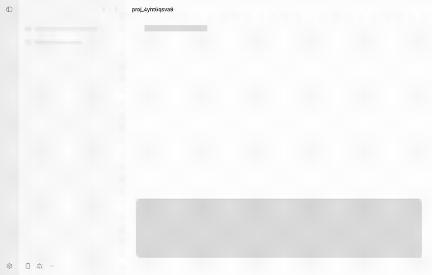
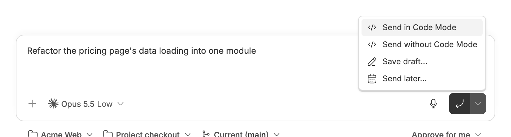
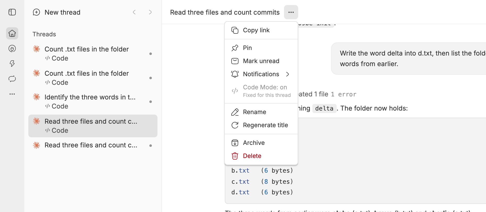
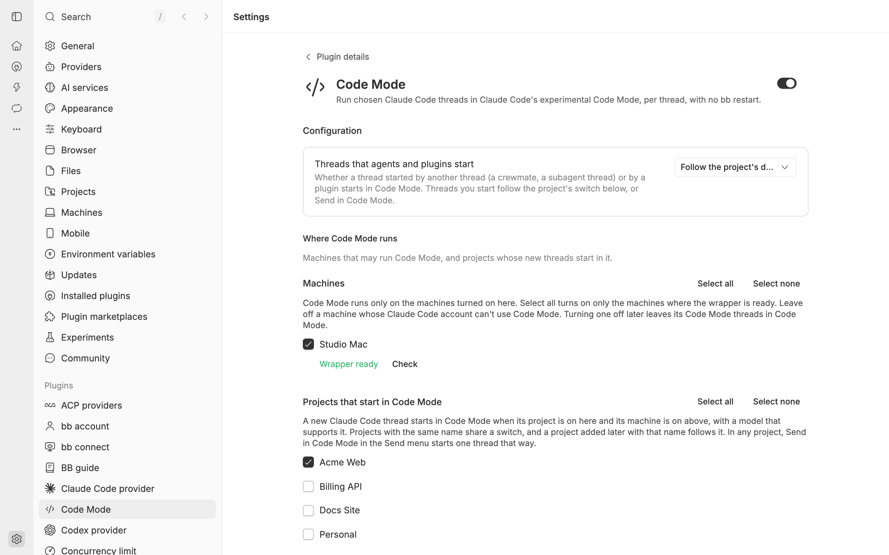

# Code Mode (code-mode)

Run the Claude Code threads you choose in Claude Code's experimental Code Mode, one thread at a time,
with no environment variable to set and no bb restart.

In Code Mode, Claude writes a short script that reads files, runs commands and calls tools in one go,
instead of one tool call per step. bb has no switch for it: Claude Code takes Code Mode for an Agent SDK
session (the way bb runs a thread) only from the `env` block of its `--settings`, and bb's settings for
Claude Code have no `env`. This plugin hands bb a small wrapper as the thread's Claude Code executable,
for the threads that chose Code Mode only. The wrapper adds Code Mode to the settings bb passes and runs
the real `claude`.



## Using it

- **Send in Code Mode.** In a new thread, the menu beside the Send button has **Send in Code Mode**. It
  sends the first message and starts the thread in Code Mode. It is greyed out for agents other than
  Claude Code and for models that can't run Code Mode.
- **The choice is fixed.** A thread decides on its first message and keeps that for good: a session
  started in Code Mode can only resume in Code Mode, and one started without it only without.
- **Defaults.** On the plugin's settings page, turn on **Projects that start in Code Mode**. A new Claude
  Code thread starts in Code Mode without the menu when its project is on there and its machine is on
  under **Machines**. Projects are listed once per name: bb projects with the same name (one per machine,
  or two checkouts) share a switch, and a project you add later with that name follows it.
- **Threads that agents and plugins start** (a crewmate, a child thread, a plugin's thread) follow the
  setting of that name: the project's default (the default), never, or the same as the thread that
  started them.
- **Forks** take the choice of the thread they were forked from.
- **Which machines.** Code Mode runs only on the machines you turn on, under **Machines** on the settings
  page. All are off until you do. Leave a machine off when its Claude Code account can't use Code Mode:
  Claude Code refuses it for an organization under HIPAA, for one, and then starts with the ordinary
  tools. Turning a machine on writes the wrapper there and says whether that worked.
- **Select all / Select none** sit beside both lists. Select all on **Machines** turns on only the
  machines where the wrapper is ready; any other machine stays off and shows why (offline, Windows, no
  usable Node). It can't tell an account that refuses Code Mode, so check that list afterwards.
- **Models.** Code Mode works with Opus 5.5, Sonnet 5.5, Fable 5.2 and later models. A message that would
  move a Code Mode thread to another model is refused with the reason, because the thread could not
  resume on it. Switch the thread back and send again.
- **Seeing it.** A Code Mode thread shows a **Code** badge on its row in the thread list (when the list
  shows metadata: Organize → Rows → Metadata), and **Code Mode: on · Fixed for this thread** in its
  thread menu.

Threads that existed before you installed the plugin are never touched.

| The Send menu | A Code Mode thread |
| --- | --- |
|  |  |

The settings page ([dark](docs/screenshots/settings-dark.png)):



## If the plugin is off or fails

**A Code Mode thread can't resume without this plugin.** If the plugin is turned off, removed, or fails
to load, the next message to a Code Mode thread fails with "This session was started in Code Mode
(experimental), which is off in this run, so it can't be resumed". The same happens if the wrapper
can't be written on that thread's machine.

To recover a thread once the plugin is back:

1. Stop the thread (its Stop button, or `bb thread stop <id>`).
2. Send a new message.

Turning the plugin back on alone is not enough: bb keeps the executable it picked for a running thread
until the thread stops. **Try again** on the failed message sends "Please continue." rather than your
message, so send your message again after recovering.

The same steps recover a Code Mode thread that was moved to an older model outside bb's send (for
example with `bb thread update --model`): set a supported model, stop the thread, and send a new message.

## Good to know

- **Code Mode is experimental**, in Claude Code and in bb's plugin API this uses. Either can change.
- **bb shows the script's steps as ordinary rows** ("Explored 3 files, ran 2 commands"); the script itself
  is not shown.
- **Sandboxing:** with bb's sandbox on, the sandbox covers the shell commands a script runs, not the
  script itself or its file, web and tool calls.
- **Don't combine it with a global wrapper** set through `bb-app env set BB_CLAUDE_CODE_EXECUTABLE`; the
  plugin's choice wins for its threads, which is confusing.
- **macOS and Linux machines only.** The wrapper is a shell script run with bb's own Node; it needs no
  Python.
- The wrapper logs one line per Claude Code launch in `wrapper.log` beside it, in the plugin's host-data
  folder on each machine (`~/.bb/plugins/code-mode/host-data/` on the bb server's Mac). It records the
  time, the thread and session ids and its decision, never the arguments or environment.

## Install

```bash
bb plugin install 'git:github.com/gpambrozio/bb-plugins@>=0.1.0' --plugin code-mode --tag-prefix code-mode/
```

Needs bb 0.50 or later; tested with bb 0.50.1 and Claude Code 2.1.332. Then open **Settings → Plugins → Code Mode**
and turn on the machines that may run Code Mode.
