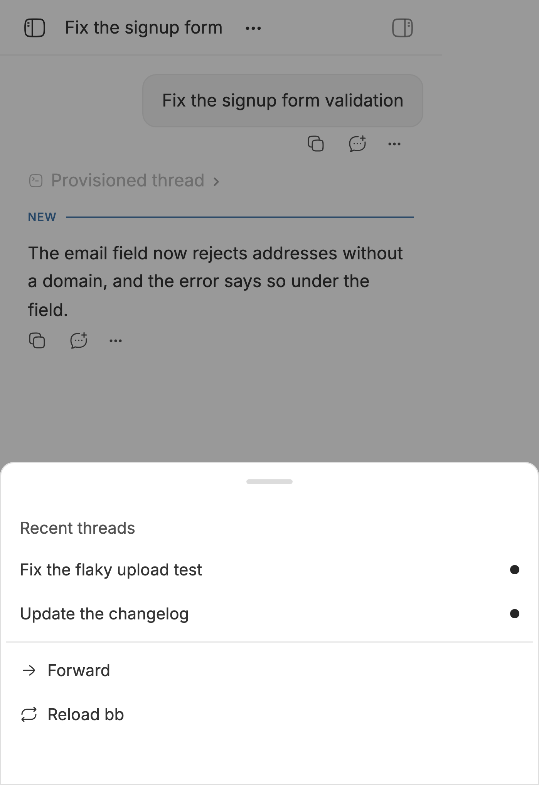
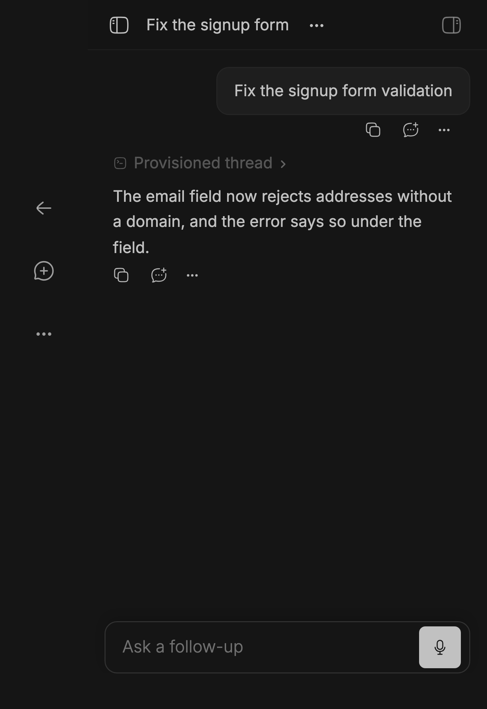

# Duo Rail (duo-rail)

Put bb's controls in the empty strip below the camera on the iPhone Duo's folded cover screen.

Folded, the iPhone Duo keeps an 84-point strip down one side of its cover screen for the camera and a
vertical status bar. Those take the strip's top 175 points or so; the rest is blank, and bb leaves it
blank. Duo Rail puts a column of buttons there, at the top of the strip, the way Apple places a Duo
app's own controls: symbol-only, primary navigation first.

- **Back** returns to the screen you were on before.
- **New thread** opens the new thread screen.
- **More** opens a sheet with your five most recent threads (a dot marks one that is waiting for you
  or has an unread reply), **Forward**, and **Reload bb**.

Everywhere else (a desktop, an ordinary iPhone, the Duo unfolded, Split View) it draws nothing.

## Screenshots

On the cover screen (466 × 678 points), with the insets the Duo reports simulated in a browser:

| Light | Dark | More | Mirrored device |
| --- | --- | --- | --- |
|  |  |  |  |

With bb's sidebar drawer open, the rail steps aside: [screenshot](docs/screenshots/cover-drawer-open.png).

## What you need

bb 0.49 or later, and an iPhone Duo with bb's iOS app. No account, service or API key.

## Install

From the pull request's branch, to try it before it is released:

```bash
bb plugin install 'git:github.com/gpambrozio/bb-plugins@fm/duo-rail-plugin' --plugin duo-rail
```

Once released:

```bash
bb plugin install 'git:github.com/gpambrozio/bb-plugins@^0.1.0' --plugin duo-rail --tag-prefix duo-rail/
```

From a clone:

```bash
cd duo-rail
npm ci && bb plugin build
bb plugin install "path:$PWD" --yes
```

## Setting

**Space for the camera (points)**, in Settings → Plugins → Duo Rail, default 175: how far below the top of
the screen the first button sits. bb cannot tell a plugin where the camera and the clock end, so this is
a measured guess. Raise it if the first button sits under the clock; lower it to move the buttons up.
When the column would not fit between that point and the bottom of the screen (with the keyboard up, for
one), the rail hides rather than draw a cut-off button.

## When it shows

The rail shows only when all of these hold:

- bb uses its compact (phone) layout, a window narrower than 768 points;
- the page has a safe-area inset of at least 44 points on exactly one side, and none on the other;
- the page has no top inset.

That is the folded Duo's signature: right 84, top 0, bottom 34 (left 84 on a mirrored device). An
ordinary iPhone has a top inset in portrait and an inset on both sides in landscape; the Duo unfolded and
Split View have no side strip. The rail reads the insets the way bb's own layout does, from CSS
`env(safe-area-inset-*)`.

It also stays out of bb's way. bb already keeps its page out of the strip, so the rail covers none of
bb's interface and moves none of it, and only its buttons take taps. bb's drawers, sheets, dialogs,
menus and toasts all sit above it. When one of them covers a button, as bb's sidebar drawer does when it
slides the page sideways, the rail fades out until it is gone.

## What it cannot do

**Search** and **open the sidebar** were part of the plan, and neither is here. bb's SDK gives a plugin no
way to open bb's thread search or its sidebar drawer from outside the sidebar. The rail would have to
press bb's own buttons or send bb's keyboard shortcuts, and both break when bb changes. The two return
when bb adds those routes to the SDK. Until then, bb's sidebar button stays in its top-left corner, and
**More** lists recent threads.

## Only a real Duo can confirm

Everything above was tested in a browser at the cover screen's size, with the Duo's insets set through
Chromium's safe-area override. bb's page pads itself exactly as on the device there. Three things need
the real device:

- that taps in the strip below the camera reach the page in bb's iOS app, rather than being kept by the
  system;
- that 175 points clears the camera and the vertical clock (it comes from a measurement in the iOS 27.1
  simulator, where the status column is 174 points tall);
- that the strip is on the side the insets say it is on a mirrored device.

## Develop

```bash
npm install --include=dev
npm run typecheck
npm test
bb plugin build
```

Screenshots come from `tools/shots` (`npm run shots -- duo-rail`), which also checks the rail's
placement, taps and hiding in a dev bb. See `AGENTS.md` for the plugin's invariants.
