# Duo Rail (duo-rail)

Put bb's controls, your choice of them, at the bottom of the empty strip beside the screen on both of the
iPhone Duo's displays.

The iPhone Duo keeps a strip down one side of each display for the camera, the clock and the status
icons: 84 points wide on the folded cover screen, about 85 on the unfolded display. Those take the
strip's top, and the Dynamic Island grows down it when a Live Activity runs; the rest is blank, and bb
leaves it blank. Duo Rail stands a column of symbol-only buttons on the bottom of the strip, just above
the home indicator, stacking upward, so the island has room to grow over the empty part.

Out of the box, both displays get the same three:

- **Back** returns to the screen you were on before.
- **New thread** opens the new thread screen.
- **More** opens your five most recent threads (a dot marks one that is waiting for you or has an unread
  reply), **Forward**, and **Reload bb**. On the cover screen it is a sheet; unfolded, a menu beside the
  button.

You can change all of it, separately for each display, in **Buttons** on the plugin's settings page:
which buttons, in what order, each one's symbol, and what it does (see *Buttons* below).

Everywhere else (a desktop, an ordinary iPhone, an iPad, Split View) it draws nothing.

## Screenshots

On the folded cover screen (466 × 678 points) and the unfolded display (951 × 669 points), with the
insets the Duo reports simulated in a browser:

| Folded | Folded, More | Unfolded | Unfolded, More |
| --- | --- | --- | --- |
| 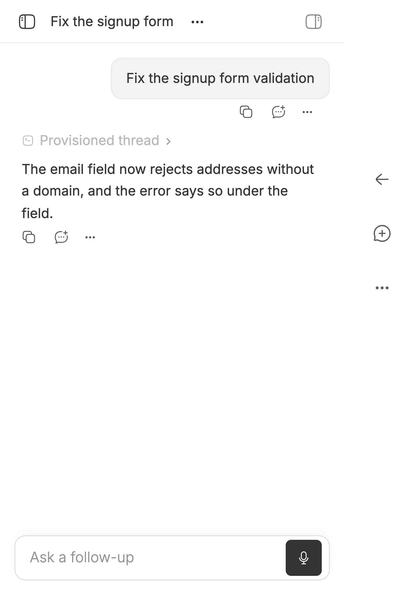 |  | 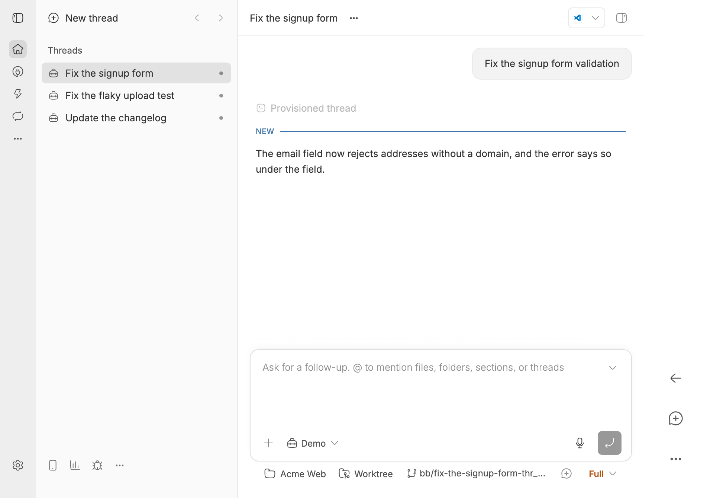 | 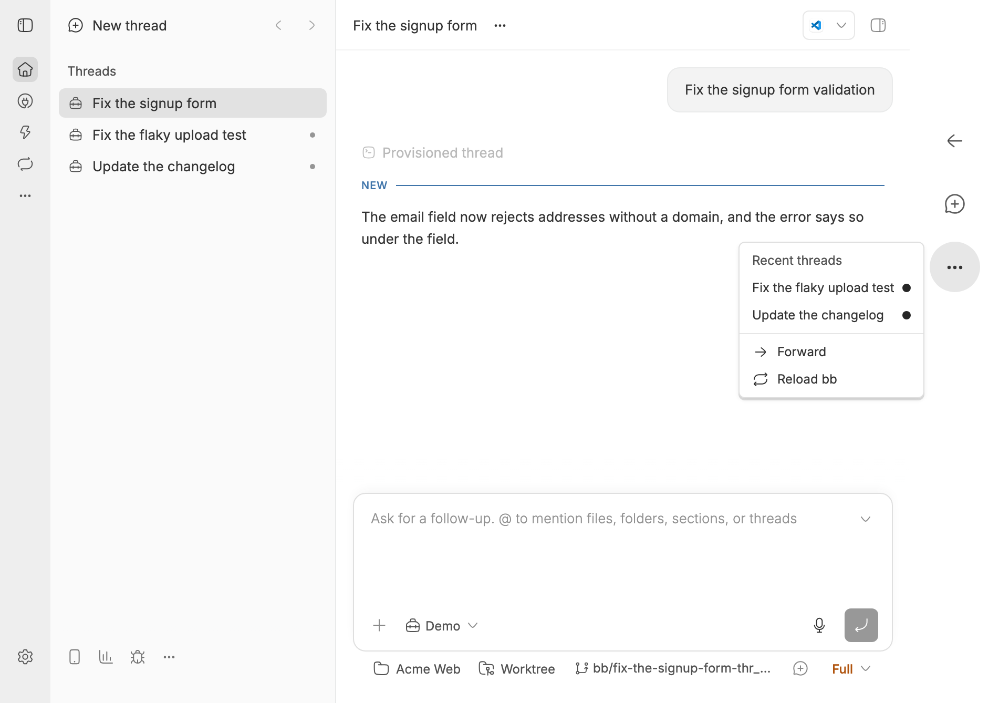 |
| 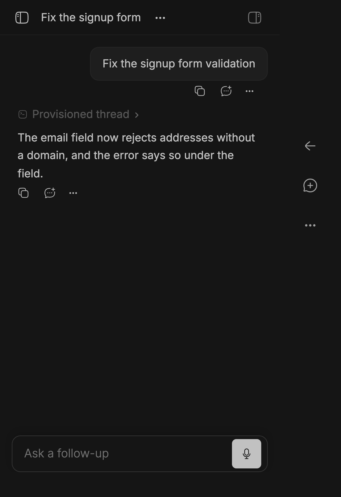 | 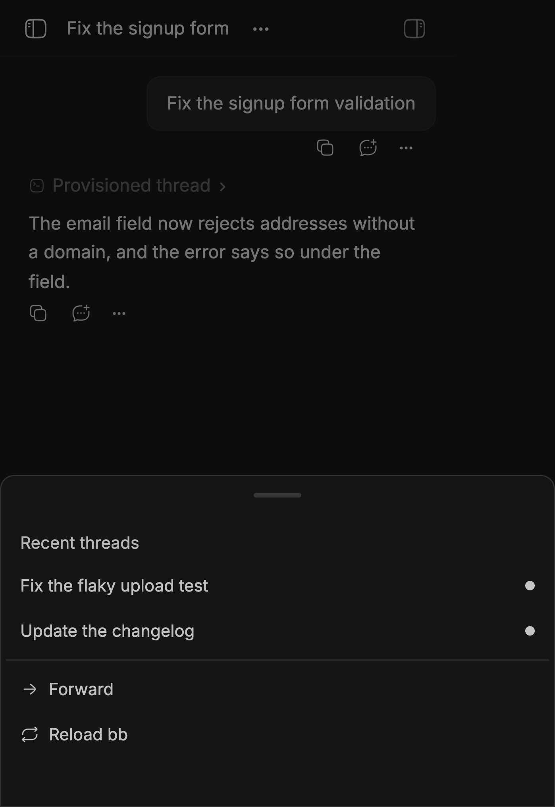 | 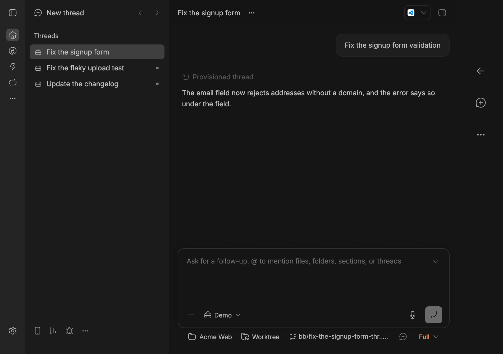 | 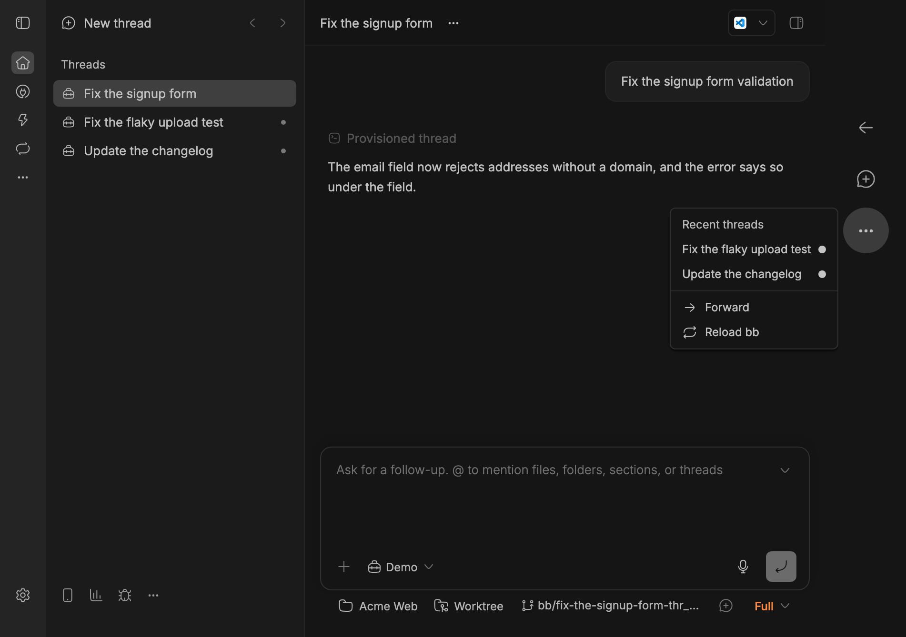 |

| The Buttons editor | Picking a command | Your own buttons |
| --- | --- | --- |
| 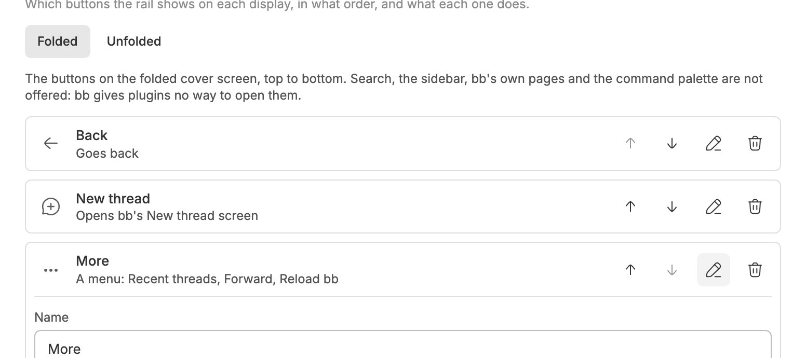 | 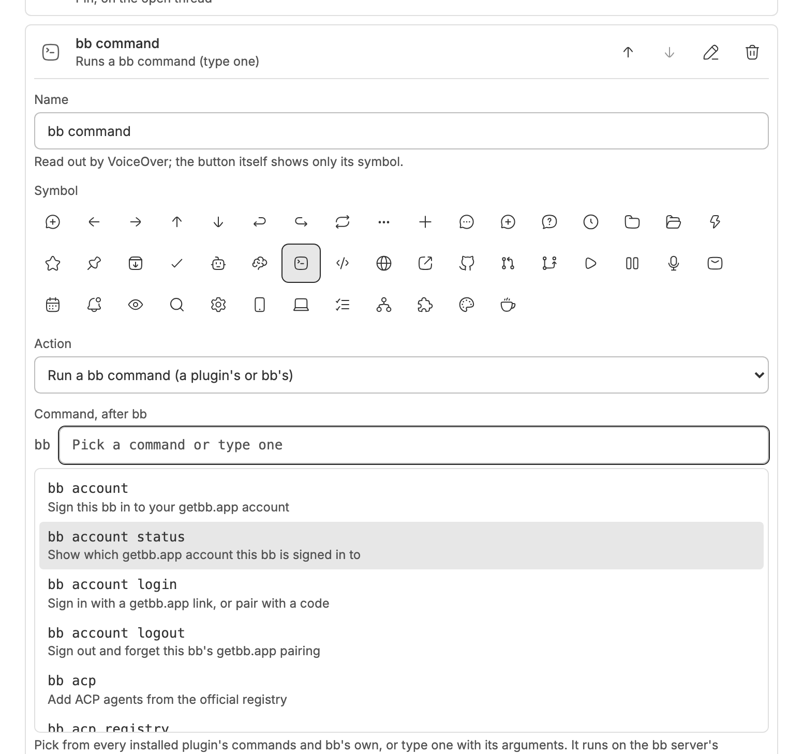 | 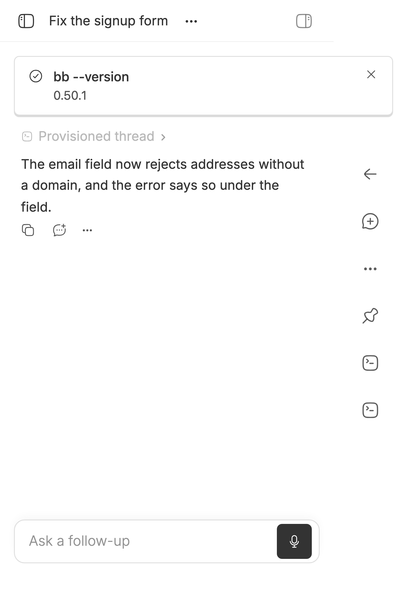 |

Dark editor: [screenshot](docs/screenshots/editor-dark.png). On a mirrored device the rail is on the left:
[screenshot](docs/screenshots/cover-mirrored-dark.png). With bb's sidebar drawer open, the rail steps
aside: [screenshot](docs/screenshots/cover-drawer-open.png). With a thread's side pane open, it stays:
[folded](docs/screenshots/cover-right-pane-dark.png), where the pane fills the screen, and
[unfolded](docs/screenshots/unfolded-right-pane-dark.png).

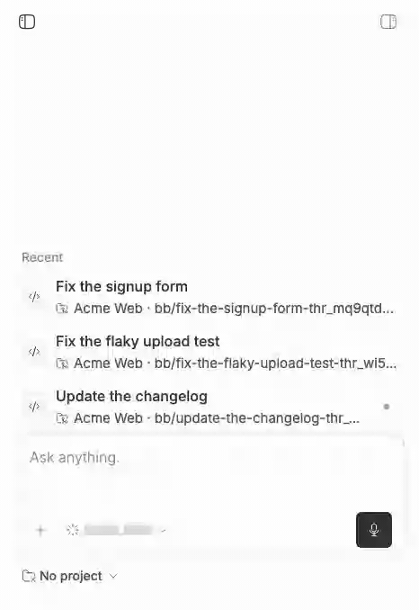

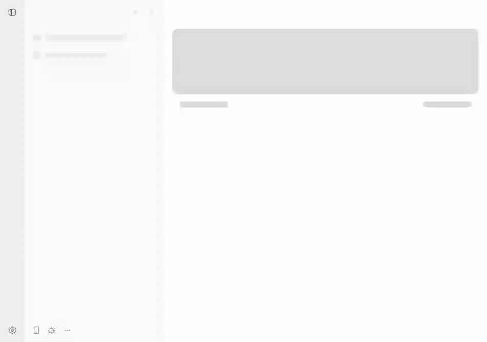

## What you need

bb 0.49 or later, and an iPhone Duo with bb's iOS app. No account, service or API key. A button that
runs a `bb` command also needs bb's command-line tool on the bb server's machine (bb's Settings → General
→ Command line).

## Install

```bash
bb plugin install 'git:github.com/gpambrozio/bb-plugins@>=0.1.0' --plugin duo-rail --tag-prefix duo-rail/
```

From a clone:

```bash
cd duo-rail
npm ci && bb plugin build
bb plugin install "path:$PWD" --yes
```

## Buttons

Settings → Plugins → Duo Rail → **Buttons**. Pick **Folded** or **Unfolded**, then add, remove and reorder
buttons. A new button opens ready to edit; give it a symbol and an action, and a name if you like (read
out by VoiceOver). Until you type a name of your own, a button is named after what you pick: the thread,
the project, the thread-menu action or the command. **Save** stores the layout in Duo Rail's own storage
on the bb server, so every device you use bb on follows it. **Copy the … buttons** copies the other
display's list; **Back to the default buttons** restores Back, New thread and More.

The symbol shows right of the name. Press it to pick another from the 181 bb draws: bb's New thread
glyph and every icon bb's own app has, in a small popover (a sheet on a phone). Type in its search box to
narrow the grid by name; each symbol says its name on hover and to VoiceOver. The grid opens on the
button's current symbol, highlighted, and closes when you pick one. A symbol a button already has that bb
no longer draws stays listed and selected, named as such, until you pick another.

| The symbol picker on a desktop | On a phone |
| --- | --- |
| 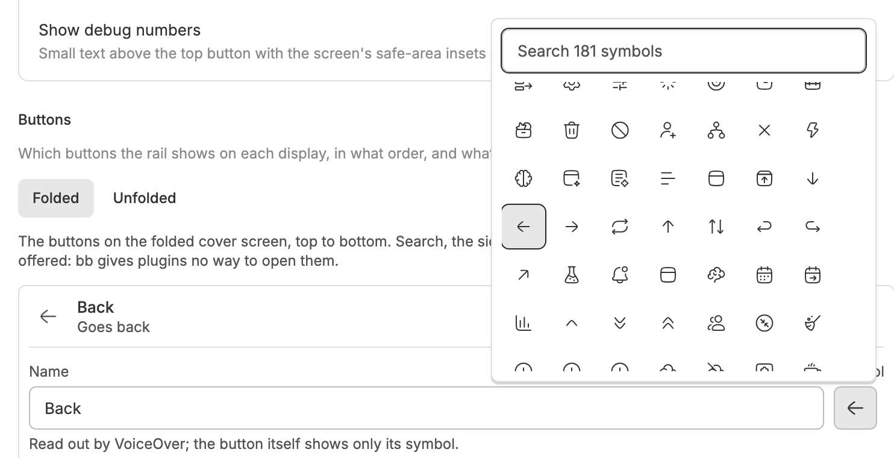 | 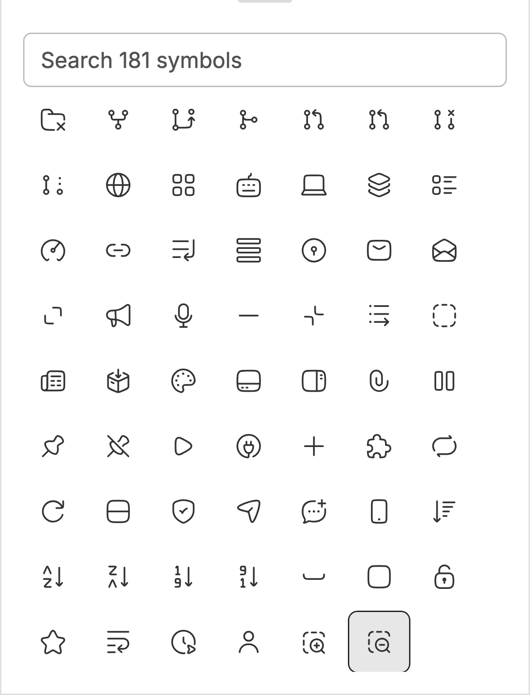 |

A button can:

| Action | What it does |
| --- | --- |
| Go back, Go forward | The page's history, as the browser's buttons would. |
| New thread | bb's New thread screen, in a project you pick or bb's own choice. |
| Recent threads | A menu of your most recent threads (1 to 10). |
| Open a thread | One thread you pick. |
| Open a project | One project you pick. |
| Thread menu action | An action from bb's thread menu, bb's own (Pin, Mark as read, Archive, Copy link, …) or another plugin's, on the thread you are looking at. Greyed out where no thread is open. An action with choices opens them as a menu. |
| Run a bb command | `bb <words…>` on the bb server's machine. The editor lists every command there is, each installed plugin's commands and subcommands and bb's own, and narrows the list as you type; add arguments after the one you pick. Its last lines come back as a notice. It is stopped after a minute, on the bb server's machine, even if the page closes first. |
| Open a URL | A web address opens in bb's browser, as your bb settings say; an app link asks first. |
| Reload bb | Reloads the page. |
| Menu | A menu of its own items, each any of the above. More is one. |

**Export** copies both displays' buttons to the clipboard as text; **Import…** takes such a text from
another bb (Save keeps it). The server refuses a layout the rail could not draw, and says why.

Up to eight buttons fit on a display. When the column would reach above the camera gap (too many buttons
for the gap you set, or the keyboard up), the rail hides rather than draw a cut-off button.

### Not offered

bb's SDK gives a plugin no way to reach these from the rail, so the editor does not offer them:

- **Search** and **opening the sidebar**;
- **bb's own pages** (Home, Automations, Settings, …) and other plugins' pages;
- **bb's command palette** and its commands, and keyboard shortcuts.

The rail would have to press bb's own buttons or send bb's shortcuts, and both break when bb changes. Until
bb adds those routes, bb's sidebar button stays in its corner and **More** lists recent threads.

## Space for the camera

Two settings, one per display, in the same place: **Space for the camera, folded** (default 175 points)
and **unfolded** (default 110). The buttons stand at the bottom of the strip whatever these say; each is
how far below the top of the screen the column may reach, and the rail hides when its buttons would reach
higher. bb cannot tell a plugin where the camera and the clock end, or how far the Dynamic Island grows
(nothing a page can read changes with it), so these are measured guesses. Raise one to keep the buttons
clear of a taller island; lower it to make room for more buttons.

## Debug numbers

For now, the rail can also show small text above its top button: which display it
thinks it is on, the camera gap in use, the four safe-area insets the page reads, the window's size, the
visual viewport's size and offset, the screen's size and its pixel ratio. They update live, on every
resize, rotation, scroll of the visual viewport and return to bb, and twice a second besides, because an
inset can change without any event. They showed that nothing the page can read changes with what the
Dynamic Island shows, a Live Activity or only the clock. They are off; turn on **Show debug numbers** on
the plugin's settings page to see them.

| Folded | Unfolded |
| --- | --- |
| 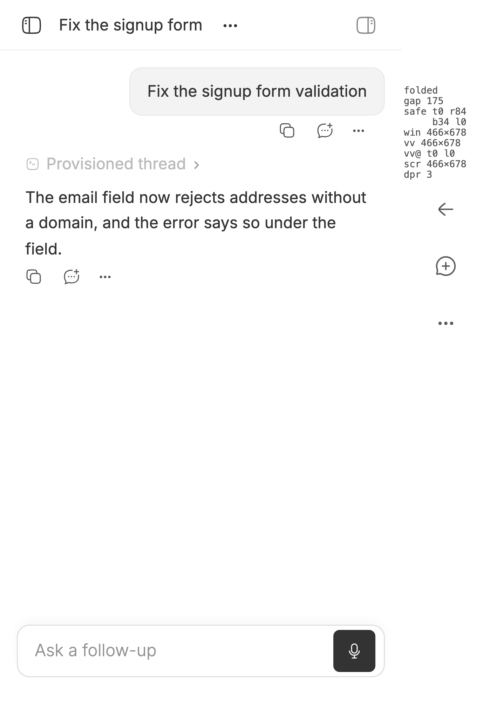 | 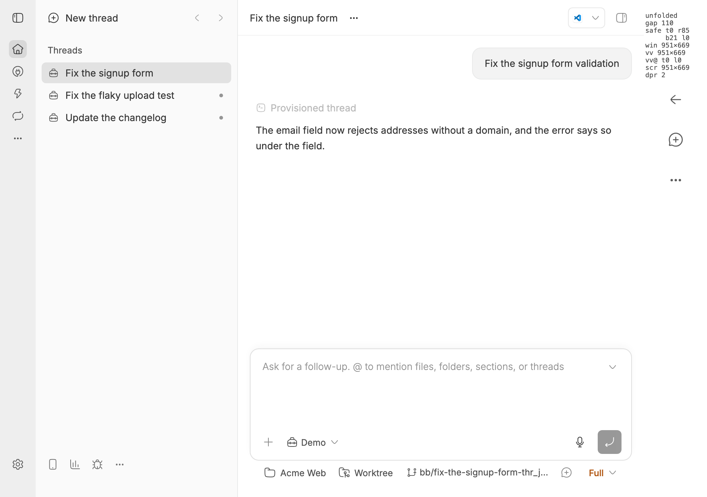 |

## When it shows

The rail shows when the page has a safe-area inset of at least 44 points on exactly one side, none on the
other, and no top inset, whatever layout bb chose. That is the Duo's signature on both displays: right 84
(or about 85 unfolded), top 0 (left on a mirrored device). An ordinary iPhone has a top inset in portrait
and an inset on both sides in landscape; a desktop, an iPad and Split View have no side strip. bb's compact
(phone) layout, which the cover screen gets, means the folded buttons; bb's wide layout, which the unfolded
display gets, means the unfolded ones. The rail reads the insets the way bb's own layout does, from CSS
`env(safe-area-inset-*)`.

It also stays out of bb's way. bb keeps its page out of the strip on both layouts, so the rail covers none
of bb's interface and moves none of it, and only its buttons take taps. A thread's side pane, which on
the cover screen fills the screen, keeps out of the strip too, and the rail stays over it. bb's sheets,
dialogs, menus and toasts sit above the rail, and it fades out while one of them covers a button. It also
fades out while bb's sidebar drawer puts bb's page or its tap-to-close layer in the strip, so taps there
close the drawer: with the strip on the right, the drawer slides the page sideways into it. On a mirrored
device, with the strip on the left, the drawer's own padding keeps the strip empty, and the rail may stay
showing there over the open drawer.

## Only a real Duo can confirm

Everything above was tested in a browser at each display's size, with the Duo's insets set through
Chromium's safe-area override. bb's page pads itself exactly as on the device there. These need the real
device:

- that taps in the strip below the camera reach the page in bb's iOS app, rather than being kept by the
  system, on both displays;
- that 175 points clears the camera and the vertical clock folded (from a measurement in the iOS 27.1
  simulator, where the status column is 174 points tall), and 110 the clock and status icons unfolded
  (read off a screenshot of the unfolded display);
- that the unfolded display reports its strip as a right inset of about 85 and no top inset, as the
  screenshot suggests, and that bb picks its wide layout there;
- that the strip is on the side the insets say it is on a mirrored device.

## Develop

```bash
npm install --include=dev
npm run typecheck
npm test
bb plugin build
```

Screenshots come from `tools/shots` (`npm run shots -- duo-rail`), which also checks the rail's
placement, taps and hiding on both displays, the editor, and a saved layout's buttons in a dev bb. See
`AGENTS.md` for the plugin's invariants.
