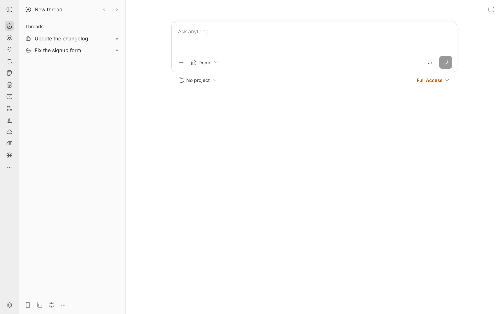
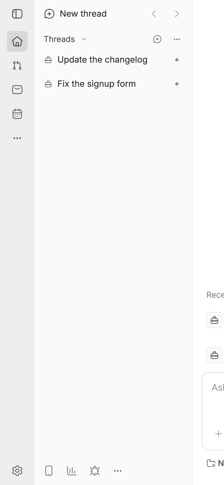
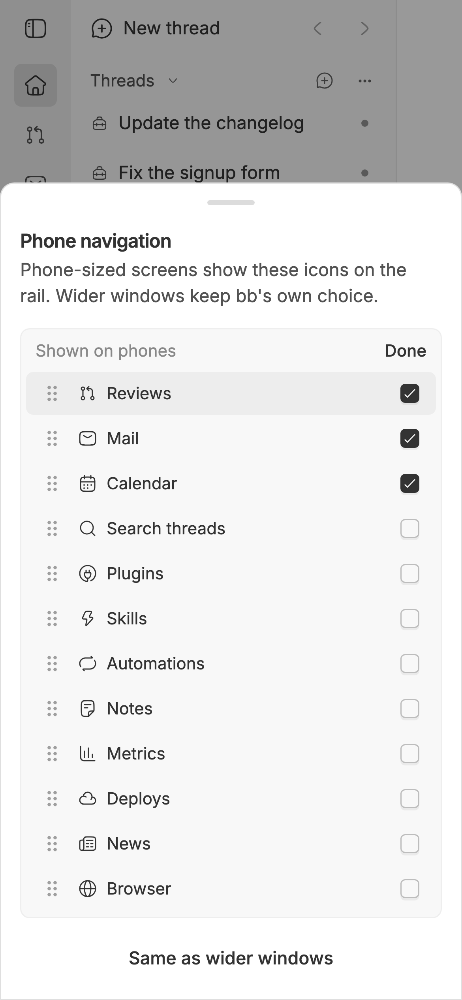

# Phone Rail (phone-rail)

Show fewer sidebar icons on your phone than on your desktop.

bb keeps one list of sidebar icons for every device: hide an icon on your phone and it disappears from
your desktop too. Phone Rail is bb's own icon rail, with one difference: phone-sized screens keep their
own set of icons, in their own order. Wider windows keep bb's shared choice, so the desktop is
untouched.

## Screenshots

| Desktop | Phone | Phone editor |
| --- | --- | --- |
|  |  |  |

Dark: [desktop](docs/screenshots/desktop-dark.png), [phone](docs/screenshots/phone-dark.png),
[phone editor](docs/screenshots/phone-editor-dark.png).

## What you need

bb 0.48 or later. No account, service or setting.

## Install

```bash
bb plugin install 'git:github.com/gpambrozio/bb-plugins@>=0.1.0' --plugin phone-rail --tag-prefix phone-rail/
```

From a clone, to try a branch before it is released:

```bash
cd phone-rail
npm ci && bb plugin build
bb plugin install "path:$PWD" --yes
```

Then pick it: **Settings → Appearance → Navigation → Phone Rail**, or

```bash
bb settings ui set sidebar.navigationProvider phone-rail/rail
```

If your navigation is set to Automatic, installing Phone Rail picks it already. Set Navigation back to
**Rail** (or disable the plugin) to return to bb's own.

## How it works

- **On a desktop window** the rail is bb's: the same icons, order, badges, menus and **Customize
  navigation** editor, all reading and writing bb's shared sidebar preferences. **More** adds
  **Customize phone navigation**, to set up the phone's icons from the desktop.
- **On a phone** the rail shows the phone's own icons. Until you change anything there, that is the same
  set as everywhere else. **Hide from rail** (long-press an icon) and **More → Customize navigation**
  change the phone's set only. The editor is bb's own list in a sheet: tick to show, drag the handle to
  reorder. **Same as wider windows** drops the phone's set and goes back to the shared one.
- **Hidden icons stay reachable** in **More**, as on bb's rail. A plugin page installed after you set
  up the phone starts in More on the phone, so the phone's rail does not grow by itself.
- **One phone set for every phone.** The set is saved on your bb server, so it survives restarts and
  every phone-sized screen shares it: the iPhone app, a phone's browser, an iPad in a narrow split.

### What counts as a phone

The SDK tells a navigation plugin one thing about the screen it draws on: whether bb is using its
compact (phone) layout. That is bb's own test, the one that moves the rail into the sidebar drawer: a
window narrower than 768 pixels. bb says nothing about which device or app is asking, so a desktop
window made that narrow uses the phone set too, and two phones cannot have different sets.

## Develop

```bash
npm install --include=dev
npm run typecheck
npm test
bb plugin build
```

Screenshots come from `tools/shots` (`npm run shots -- phone-rail`); see `AGENTS.md` for the
plugin's invariants.
