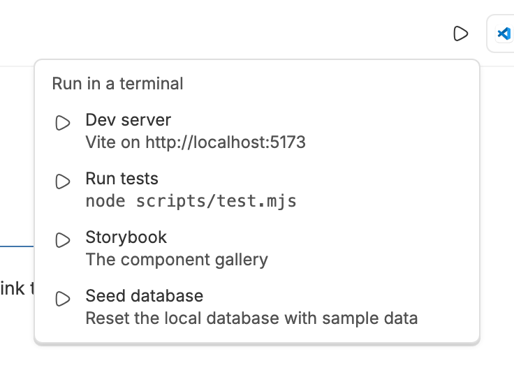
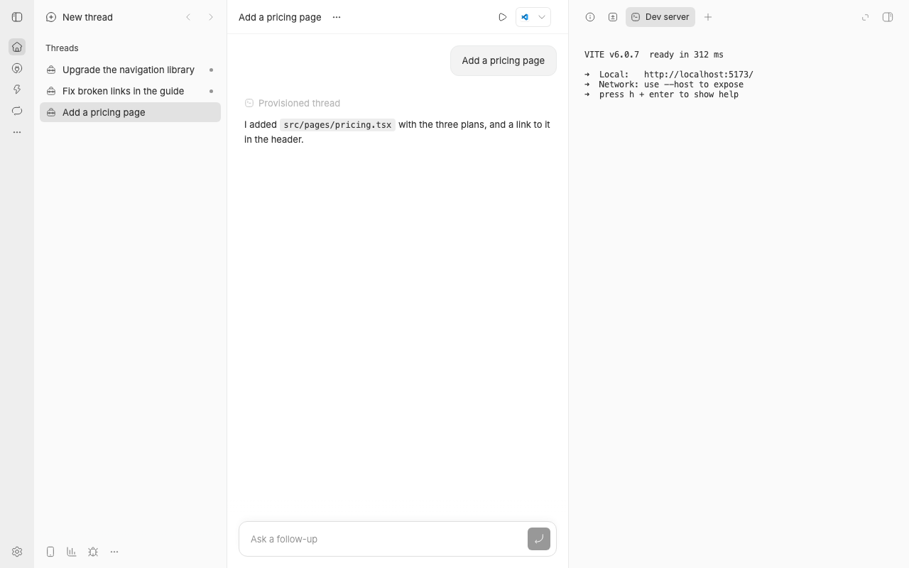
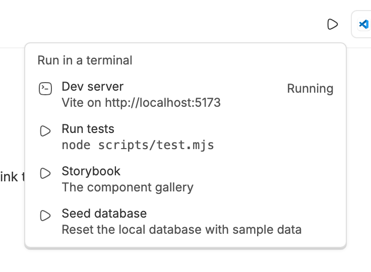
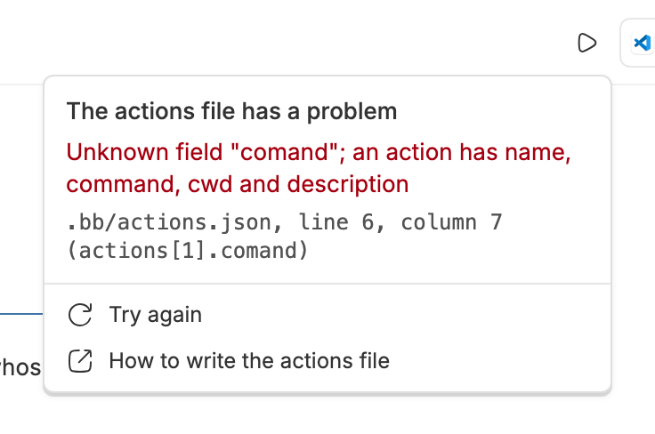
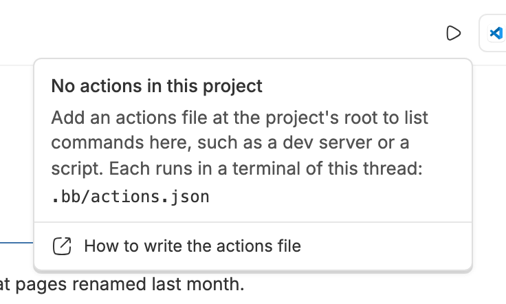

# Project Actions

Runs your project's named commands — start the dev server, run the tests, seed the database — from a
menu in each thread's header. Each one runs in a terminal of that thread, in the thread's own
workspace (its worktree), and opens in bb's terminal panel.

The list lives in the project, in `.bb/actions.json`, committed like any other file, so every worktree
reads its own branch's version and everyone who opens the project gets the same menu.

## Screenshots

<picture>
  <source media="(prefers-color-scheme: dark)" srcset="docs/screenshots/menu-dark.png">
  
</picture>

_The menu, from the play button in the thread's header. Each action shows its description, or its command when it has none._

<picture>
  <source media="(prefers-color-scheme: dark)" srcset="docs/screenshots/running-dark.png">
  
</picture>

_Picking an action opens a terminal titled with its name in the thread's terminal panel._

<picture>
  <source media="(prefers-color-scheme: dark)" srcset="docs/screenshots/menu-running-dark.png">
  
</picture>

_An action still running says so. Picking it again shows its terminal instead of starting a second one._

<picture>
  <source media="(prefers-color-scheme: dark)" srcset="docs/screenshots/invalid-dark.png">
  
</picture>

_A mistake in the file is shown with the line, the column and the action it is in._

<picture>
  <source media="(prefers-color-scheme: dark)" srcset="docs/screenshots/empty-dark.png">
  
</picture>

_A project without the file explains how to add one._


## The actions file

`.bb/actions.json` at the root of the project's repository:

```json
{
  "actions": [
    { "name": "Dev server", "command": "npm run dev", "description": "Vite on http://localhost:5173" },
    { "name": "Run tests", "command": "npm test" },
    { "name": "Storybook", "command": "npm run storybook", "cwd": "packages/ui" },
    { "name": "Seed database", "command": "./scripts/seed.sh --reset", "description": "Sample data for local work" }
  ]
}
```

| Field | Required | What it does |
| --- | --- | --- |
| `name` | required | What the menu and the terminal's tab say. Unique in the file (ignoring case), up to 80 characters. |
| `command` | required | What runs, as you would type it in a terminal. It runs in your login shell (`$SHELL -lc`, as bb's own `bb terminal create --command` does), so your `PATH` from your login files and your shell's syntax, such as `&&`, work. |
| `cwd` | optional | The folder to run in, relative to the repository's root (`packages/ui`). It cannot leave the repository. The root by default. |
| `description` | optional | A line under the name in the menu, in place of the command. |

The file is strict JSON: no comments and no trailing commas, so `jq` and other tools read it too. An
optional `$schema` key is allowed. Anything else, such as a misspelt field, is refused with where it is,
rather than ignored.

The menu reads the file each time it opens, from the thread's own workspace, on the machine that holds
it — a thread on another bb machine reads that machine's copy. An edit shows up the next time you open
the menu, with no reload.

## Running an action

Picking an action starts a terminal in the thread, titled with the action's name, in the thread's
workspace (or its `cwd`), and opens it in bb's terminal panel beside the thread.

- **Still running?** Picking it again shows its terminal; it does not start a second copy. The menu says
  *Running* beside it.
- **Finished?** The terminal stays open with the output and a line saying how it ended, such as
  *[Run tests ended with exit code 0. Press Enter to close this terminal.]*, and the menu says
  *Finished*. Picking it again closes that terminal and starts a fresh run.
- **Stopping one:** Ctrl+C in its terminal stops the command and shows how it ended; closing the
  terminal's tab ends it.

Runs are per thread: two threads, in two worktrees, each run their own dev server.

Actions run on macOS and Linux machines. A thread whose workspace is on Windows gets a message instead.

## Install

```bash
bb plugin install 'git:github.com/gpambrozio/bb-plugins@>=0.1.0' --plugin project-actions --tag-prefix project-actions/
```

Needs bb 0.49 or newer. Nothing to configure.

## Privacy and safety

The plugin runs exactly the commands in the project's actions file, and only when you pick one. It
reads no other file and sends nothing anywhere. The commands run with your permissions on the machine
that holds the workspace, as they would in a terminal you opened yourself, so treat a repository's
actions file like any script in it: read it before you run it.
