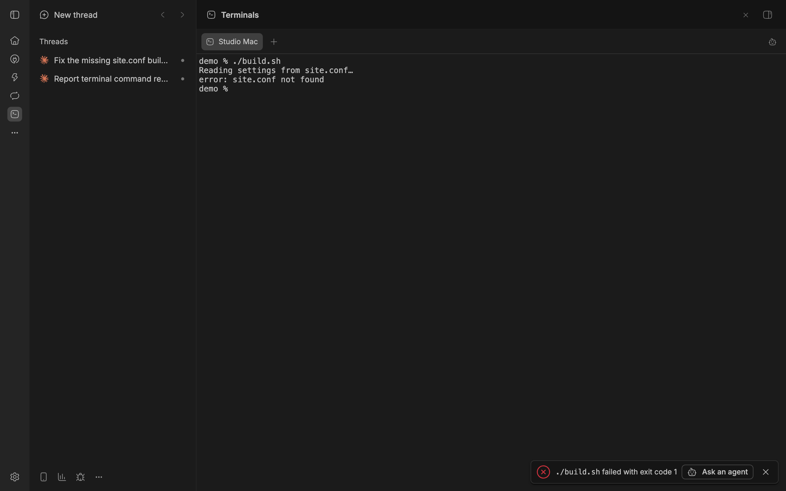
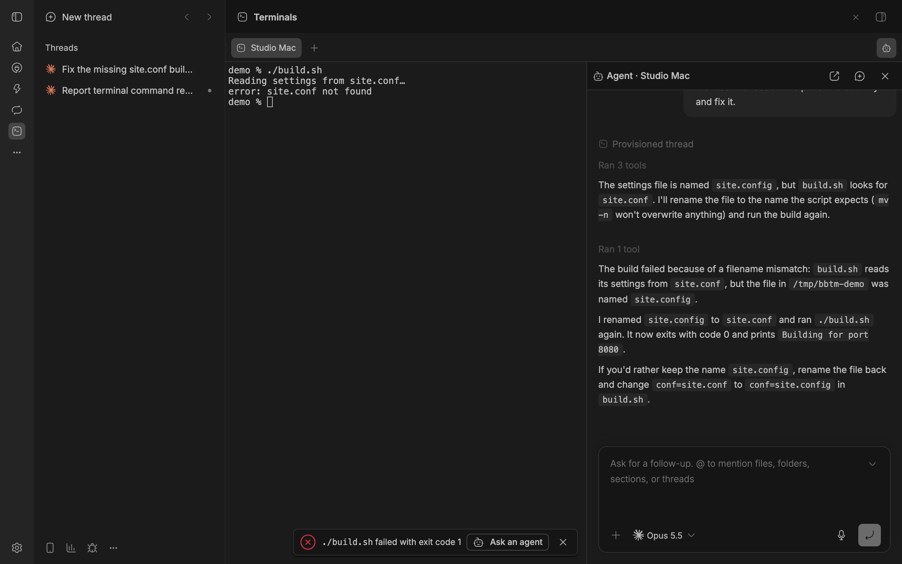
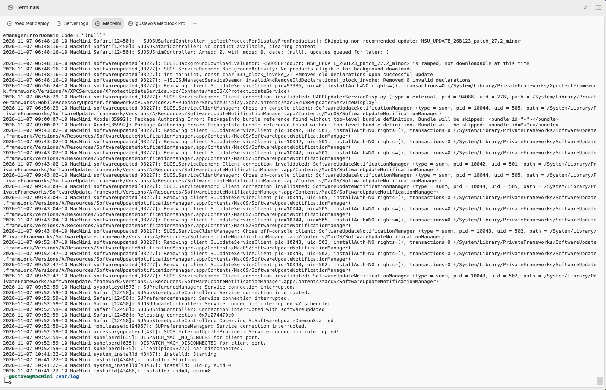
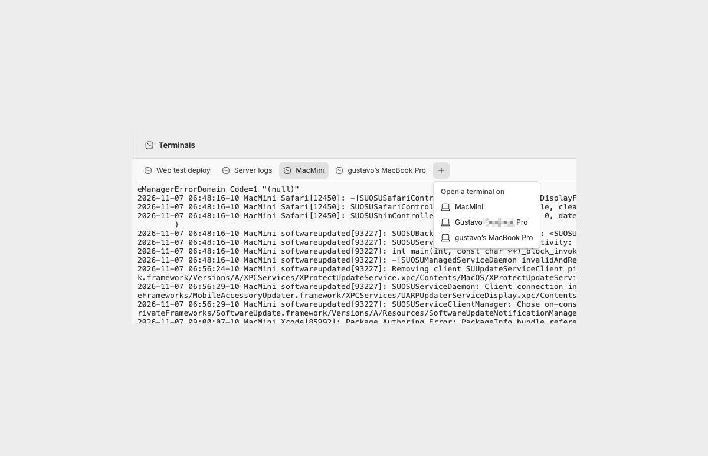

# Terminals (terminals)

Shells on any machine connected to bb, as tabs on one sidebar page — no project, thread or checkout
needed. Each terminal opens in that machine's home folder, as a new window in a terminal app does.

The **Terminals** page starts empty. **+** at the end of the tab strip opens a terminal: with one
machine connected it opens there straight away; with several, it lists them and you pick one. The
machine running the bb server is listed first.

- **Tabs** look and work like the tabs in bb's own panels. They are named after their machine,
  numbered in the order they were opened when a machine has more than one ("Mac mini 1",
  "Mac mini 2"). Close one with the **×** that shows on the tab under the pointer, a middle click, or
  its right-click menu, which also has **Close other tabs** and **Close tabs to the right**; closing a
  tab ends its shell. When the tabs do not fit, arrows at either end scroll them, as does the mouse
  wheel over the strip.
- **Drag a tab** to move it. The order is saved with the tabs, so every window shows it and it
  survives a reload. A tab keeps its number wherever it goes ("Mac mini 2" may sit before
  "Mac mini 1").
- **Rename a tab** by double-clicking its title, choosing **Rename** from its right-click menu, or
  pressing F2 on it, then type in place: Enter (or clicking elsewhere) saves, Escape keeps the old
  name, and an empty name brings back the default title. Names are saved with the tabs, so every
  window shows them and they survive a reload; a renamed tab's tooltip still names its machine, and
  `bb terminal list` shows the same title.
- **Leave the page and come back** and everything is where it was: every tab, the one you were on,
  and each terminal's scrollback at the line you had scrolled to. Whatever was running kept running,
  and kept printing, while you were elsewhere in bb.
- **Reload or reopen the app** and every tab reattaches to its shell, with the last half megabyte of
  its output replayed.
- **The same tabs everywhere.** The tab list belongs to your bb, not to a window: the desktop app and
  bb in a browser through getbb.app show the same tabs and type into the same shells. Which tab is
  shown is each window's own. A shell has one size: the window you are using (showing, resizing,
  returning to or typing in) sets it, and the others draw the shell at that size.
- **A machine that goes offline** marks its tabs "(offline)" and says so above the terminal; when it
  reconnects, the shell carries on where it was.
- **A shell that ends** (you typed `exit`, or its machine restarted) keeps its output on screen with
  the exit code and a **Close tab** button, also after a reload, for as long as its machine keeps that
  output (30 minutes). The next time the plugin loads, tabs whose shell has ended
  are dropped.

- **Select text** and an **Add to chat** button floats by the pointer, as in bb's own terminal. A
  tab belongs to no chat, so it asks which one: an open thread (searchable by title or project, the
  most recent first) or **New thread** in a project. The project starts on the one whose checkout or
  worktree holds the shell's current directory, when the shell reports it (many do, with the OSC 7
  sequence on each prompt), else on the one you picked last time in this browser, else on your most
  recent thread's. bb then opens that chat and the selection lands at the end of its message box as a
  fenced block headed with the tab and machine it came from. Nothing is sent: you read it over and
  send it yourself. Should the chat not open within 15 seconds, the block goes to the clipboard
  instead.
- **Copy on select** follows bb's own setting, Settings → General → Terminals → **Copy on select** (on unless
  you turned it off): finishing a selection copies it and shows "Selection copied", exactly as bb's
  terminal does. Turning it on or off in Settings counts at once. Only a selection you make with the
  mouse is copied, never one a program or new output makes.

The colours and font follow bb's theme, as bb's own terminal does.

## Ask an agent

- **A command fails** and, when the shell reports it (see *Seeing failed commands* below), an
  **Ask an agent** card shows at the bottom of the terminal with the command and its exit code. It
  goes away when you type in the terminal, press its **×**, or the next command runs. Stopping a
  command with Ctrl-C (exit code 130) is not offered.
- **Ask an agent** opens a panel beside the terminal (over it on a phone) with bb's new-thread box,
  filled in with "The last command I ran returned an error. Help me debug." The terminal's output is
  not pasted in: the agent is told which tab you are working in and reads the command, its output and
  exit code from the terminal itself. You can edit the message, pick the agent and model, and send it. The project starts on the one whose
  checkout holds the shell's directory, working in that checkout on the terminal's machine, else as
  for **Add to chat**. The provider and model start on bb's defaults for that project.
- **The bot button** at the right end of the tab strip opens and closes the panel at any time, with
  no failed command needed: a new chat starts empty, or on the same line when the last command failed.
- **One chat per tab.** Once the tab has a chat, the panel shows it (bb's own chat, the same one the
  sidebar lists), and asking about another failure sends it to that chat straight away. The chat's
  **new chat** button lets go of it and starts over; **open in bb** shows it as a normal thread.
- **The agent can read the terminal and run commands in it.** That chat gets two tools for that tab
  only: one reads what the terminal shows now, the other types one command at your prompt, waits for
  it to finish and reads back its output and exit code. You see the command typed in your shell, a
  note at the top of the terminal says "The agent ran …" until you type there yourself, and the tab's
  icon turns into the bot meanwhile. It never types while a command is running, into a full-screen
  program (an editor, a pager), or over something you have typed and not run yet. A command still
  running after its wait (30 seconds unless the agent asks for longer) is left running.
- **Ask it to run something and it runs it in that terminal**, not in a shell of its own, without
  asking you to confirm first. Commands it decides to run by itself stay to looking around; it asks
  before anything destructive, slow, or that needs a password.
- No other thread gets those tools. Letting go of the chat, or closing the tab, takes them away.
- **You can change what the agent is told.** The gear at the end of the tab strip, next to the bot
  button, opens the plugin's settings (Settings → Plugins → Terminals), as does the one in the agent
  panel. Its **Agent instructions** section shows the built-in text: edit it, add to it, save, or
  **Restore the built-in instructions**. Saving an empty text does the same.
  The plugin always puts one line of its own first, naming the tab and its machine and saying the two
  tools act on it, so the agent knows its terminal whatever you write. `{{tab}}` and `{{machine}}` in
  your text become the tab's name and its machine's, in quotes. A change applies to chats started
  afterwards, and to an existing chat when its agent session next starts.

The agent runs on your own agent provider, so a chat costs what any other bb thread costs.

### Seeing failed commands

The page knows a command failed only when the shell marks its prompts and each command's exit status
with the OSC 133 sequences many terminals use. Without them, everything else works, including the bot
button and both tools, but no card offers help, and the agent is told it cannot see exit codes: a
command it runs is read back once its output goes quiet.

- **Out of the box:** fish 4 and later, and nushell. A prompt framework or shell-integration script
  you already load may send them too.
- **zsh** (macOS's default) and **bash** do not. To add them, put the matching lines at the end of
  your `~/.zshrc` or `~/.bashrc` and open a new tab. The plugin never edits these files for you.

zsh:

```zsh
# bb Terminals: mark the prompt and each command's end and exit status (OSC 133),
# and say the directory (OSC 7), so the Terminals page sees failed commands.
_bb_term_precmd() {
  local code=$?
  if [[ -n $_bb_term_running ]]; then printf '\e]133;D;%s\a' "$code"; fi
  _bb_term_running=
  printf '\e]133;A\a\e]7;file://%s%s\a' "$HOST" "$PWD"
}
_bb_term_prompt_end() { [[ $PS1 == *$'\e]133;B'* ]] || PS1+=$'%{\e]133;B\a%}'; }
_bb_term_preexec() { _bb_term_running=1; printf '\e]133;C\a'; }
precmd_functions=(_bb_term_precmd $precmd_functions _bb_term_prompt_end)
preexec_functions+=(_bb_term_preexec)
```

bash (3.2, as macOS ships it, and later):

```bash
# bb Terminals: mark the prompt and each command's end and exit status (OSC 133),
# and say the directory (OSC 7), so the Terminals page sees failed commands.
_bb_term_prompt_start() {
  local code=$?
  _bb_term_ready=
  if [[ -n $_bb_term_running ]]; then printf '\e]133;D;%s\a' "$code"; fi
  _bb_term_running=
  return $code
}
_bb_term_prompt_end() {
  printf '\e]133;A\a\e]7;file://%s%s\a' "$HOSTNAME" "$PWD"
  _bb_term_ready=1
}
_bb_term_preexec() {
  [[ -n $_bb_term_ready && $BASH_COMMAND != _bb_term_prompt_start* ]] || return 0
  _bb_term_ready=
  _bb_term_running=1
  printf '\e]133;C\a'
}
PROMPT_COMMAND="_bb_term_prompt_start${PROMPT_COMMAND:+; $PROMPT_COMMAND}; _bb_term_prompt_end"
PS1="$PS1"'\[\e]133;B\a\]'
trap '_bb_term_preexec' DEBUG
```

The bash lines take over the `DEBUG` trap; if you already set one (bash-preexec does), add the
`_bb_term_preexec` call to it instead. Other shells (PowerShell, sh) need an equivalent of their own.

## Screenshots



_A command fails: the card offers to ask an agent._



_The agent panel: the tab's own chat, beside the shell it reads and runs commands in._



_The Terminals page: one tab per shell, on any enrolled machine._



_The **+** menu opens a new terminal on any enrolled machine._

## What you need

- bb 0.48 or later.
- At least one machine connected to bb. A terminal runs that machine's own shell (`$SHELL`, else zsh,
  bash or sh; PowerShell on Windows), as the user bb runs as there.

## Install

```bash
bb plugin install 'git:github.com/gpambrozio/bb-plugins@>=0.1.0' --plugin terminals --tag-prefix terminals/
```

From a clone, to try a branch before it is released:

```bash
cd terminals
npm ci && bb plugin build
bb plugin install "path:$PWD" --yes
```

The page is **Terminals** in the sidebar.

## How it works

Each tab is one of bb's own terminal sessions (the ones `bb terminal` manages), started in the chosen
machine's home folder. The shell runs under that machine's host daemon and bb buffers its output, so
it does not depend on the page, the window or the app being open. The plugin's server half only
remembers which sessions are tabs, in which order. The page draws each one with
[xterm.js](https://xtermjs.org), the terminal emulator bb's own terminal uses, and streams it over bb's
terminal connection — the one bb's terminal panel uses — on the page's own origin. No port is opened
and nothing new listens anywhere.

Nothing is stored but the list of tabs (machine, session id and the name you gave it), which chat
helps with which tab, and your own agent instructions if you changed them. No output, keystroke or credential is written to the plugin's storage or its
log. What you send an agent, and what its tools read, is in that chat, like any other bb thread.

The agent's tools reach the shell the same way: they read bb's kept output for that one terminal and
type into it through bb's terminal API. The plugin's server checks on every call that the calling
thread is the tab's chat.

## What happens when

| Event | Shells | Tabs |
| --- | --- | --- |
| You switch to another bb page | keep running | kept, with scrollback and position |
| You reload or close and reopen the app | keep running | reattach, last 512 KB replayed |
| A machine goes offline | wait for it | marked offline, resume when it reconnects |
| The bb server restarts | bb reattaches each one whose machine's daemon kept running | kept; ended ones dropped |
| A machine's bb daemon restarts (reboot, bb quit there) | end | shown as ended, dropped at the next load |
| You close a tab | end | removed everywhere |
| The plugin is reloaded | keep running | kept; ended ones dropped |

Removing the plugin does not end its shells; close the tabs first, or end them with `bb terminal list
--machine <machine>` and `bb terminal close <id>`.

## Develop

```bash
npm install --include=dev
npm run typecheck
npm test
bb plugin build
```

See [AGENTS.md](AGENTS.md) for the invariants.
