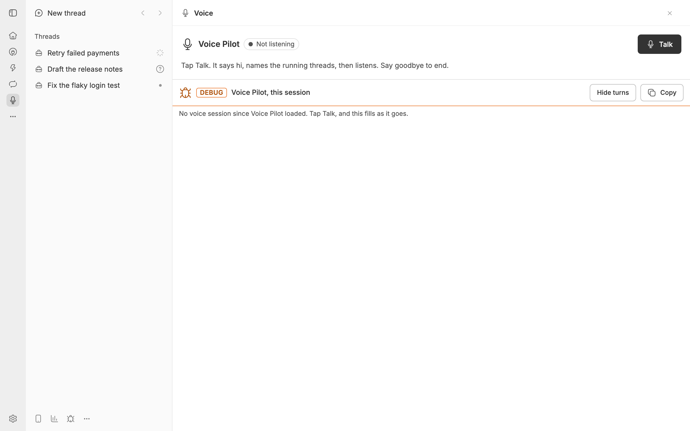
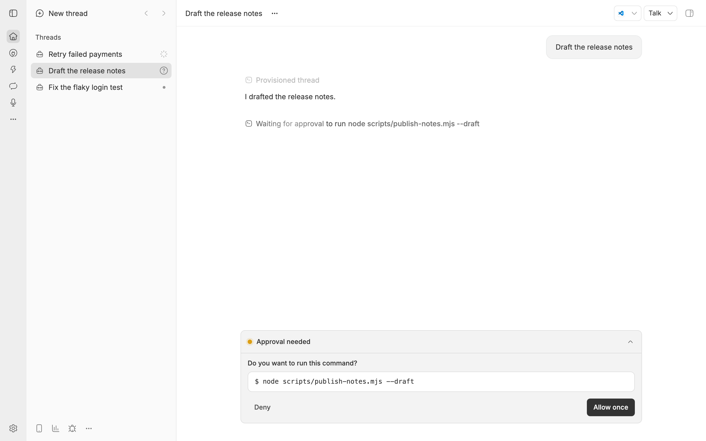
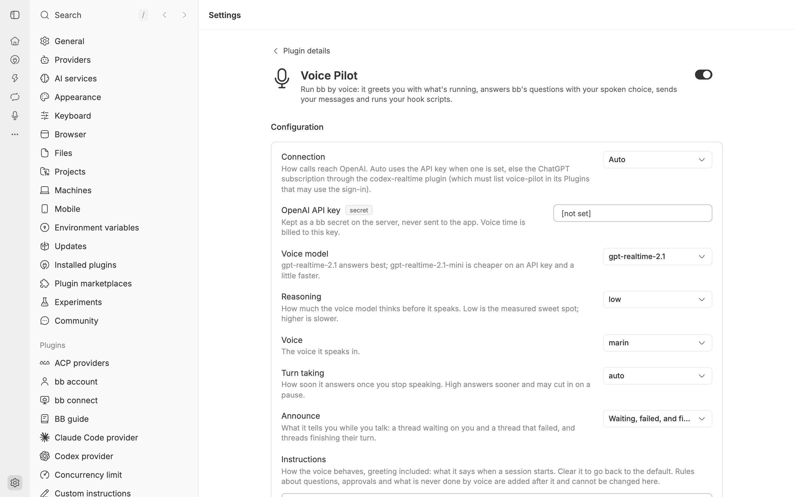
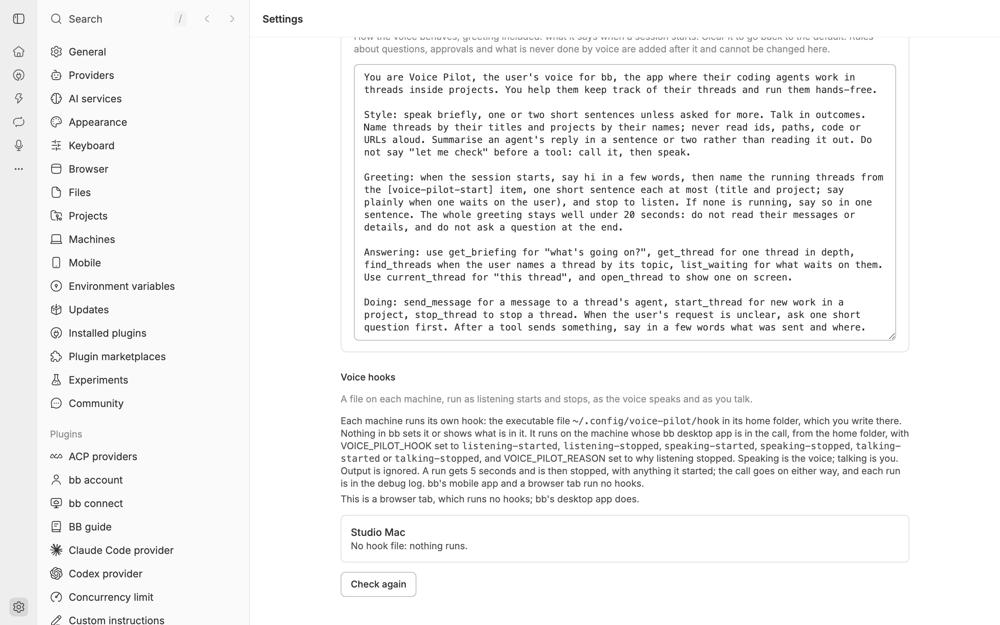

# Voice Pilot (voice-pilot)

Run bb by voice. Tap **Talk** and it says hi, tells you in a few seconds which threads are running and which
one waits on you, then listens. Ask what's going on, have it read a thread's latest reply, answer a
thread's question with your spoken choice, send a message to an agent or start new work, all without the
keyboard. It runs on OpenAI's realtime voice (`gpt-realtime-2.1`), with an OpenAI API key or your ChatGPT
subscription.



## What it does

- **Speaks first.** As soon as the call is up it greets you and names the running threads, one short
  sentence each (title, project, and whether one waits on you), at most five, well under twenty seconds,
  then waits for you. What it says is in the **Instructions** setting, which you can change.
- **Catches you up in one call:** "what's going on?" reads the whole briefing (every root thread's opening
  and latest messages, the agent's latest reply, sub-threads that need someone, project descriptions and
  FirstMate's tasks), and "what did the login one say?" reads one thread in depth.
- **Reads everything in a reply,** not only its prose: the rows of a table, a card's figures, a list of
  steps, the links. Ask "which pull requests does it list?" and it answers from the table, in a sentence.
- **Answers bb's questions.** "What's waiting on me?" finds every thread with a question or an approval
  for you and reads it out with its options, numbered. Say your choice ("the second one", "Green", or your
  own words where the question allows them) and it answers in bb, then tells you what it sent. It never
  picks for you: an option must be one of the question's own, and an answer in your own words is your
  words from the transcript, not the model's.
- **Approvals need your yes.** A command, a file change, a permission or a plan is read out; when you say
  to approve or deny it, the voice reads back exactly what it will send ("Approve the request from *Fix CI*
  to run a command: npm test, this once?") and sends it only once you say yes to that read-back. The yes is
  checked on your transcript, not the model's word.
- **Does what you ask in bb:** sends a message to a thread's agent (queued behind its running turn, never
  cutting in), starts a thread in a project with that project's defaults, stops a thread, shows a thread on
  screen, finds a thread by topic. Messages go in the voice's wording, with your own words beside them for
  the agent, and the voice says back what it sent.
- **Opens links** when you ask ("open the first one", "open the login PR"): a web page in a new tab, a bb
  thread in bb, on the device you are talking on. The session's card says what it opened. It opens links
  from what it read in this session (a reply, a finished turn); a web address it came up with itself is
  read back to you first and opened only after you say yes. Only web (http and https) and bb links.
- **Tells you what changed while you talk:** a thread that starts waiting on you, a thread that failed, and
  a thread you messaged by voice finishing its turn, told from its reply: what the agent did, any pull
  request, anything it waits on you for, in a sentence or two (turns that finish together get a line each).
  The **Announce** setting can add every root thread, or turn this off.
- **Mutes when you ask.** Say "mute" and it mutes your microphone, the same mute as the **Mute** button, and
  the session goes on: it says so, and the card says to tap **Unmute** to talk again (once muted, it cannot
  hear you, so unmuting is a tap).
- **Proposes changes to its own instructions, and you decide.** Say "from now on, call me Sam" and the voice
  stages an edit of its **Instructions**; it never applies one itself. The Voice page shows what would change
  (bb's own diff view) with **Apply**, **Tweak** (edit the proposed text, then apply it) and **Reject**, and
  the Voice entry in the sidebar shows a pencil (✎) while one waits; on bb's icon-only rail that is a dot,
  with the reason in its tooltip. One edit waits at a time: a new one replaces it, and the page says so. An
  applied edit takes effect from the next voice session; the one in progress keeps its instructions.
- **Never merges, archives, deletes or publishes, and never changes settings,** by voice. There is no tool
  for any of it (its instructions only through an edit you apply); ask and it says to do it in bb.

## What you need

- bb 0.49 or newer, and a microphone.
- One of:
  - an **OpenAI API key** in the plugin's settings (voice time is billed to it), or
  - the [codex-realtime](../codex-realtime) plugin, with `codex login` done on the machine running the bb
    server and `voice-pilot` added to its **Plugins that may use the sign-in** setting. That is an
    undocumented use of your ChatGPT subscription that OpenAI can close at any time, and voice time counts
    against your plan; read codex-realtime's README first.
- On a phone, the session pauses while bb is off the screen (below).

## Install

The plugin is not in the BB Community marketplace. Install it from this repository and follow its
releases:

```bash
bb plugin install 'git:github.com/gpambrozio/bb-plugins@>=0.1.0' --plugin voice-pilot --tag-prefix voice-pilot/
```

## Using it

- **Talk** is on the **Voice** page in bb's sidebar, in every thread's header (in the thread menu on a
  narrow screen), and in the command palette as **Voice Pilot: talk or end**. The first time, bb asks for
  the microphone.

  
- While a session is up, a card in bb's notifications says whether it is connecting, listening, hearing you
  or speaking, and what the voice last opened, with **Mute** (or **Unmute**) and **End**; the Voice page says the same with its own buttons,
  and its sidebar entry shows *Live*. Saying "goodbye" ends it too. When a session ends, the card says why,
  with **Talk** to start again.
- A session ends by itself after ten quiet minutes, and is renewed without a break at OpenAI's one-hour
  limit.
- **On a phone, switching away pauses it.** bb's mobile app stops when it leaves the screen, so the session
  pauses rather than ends: the microphone and the call stop (no voice time is spent), and the card says
  *Paused*, with **Resume** and **End**. Come back to bb and it picks up by itself: the voice says it is back,
  remembers what you were talking about, and then tells you what happened while you were away (a thread
  waiting on you, a finished turn). If it cannot pick up by itself, tap **Resume**. Half an hour away ends
  the session. On the desktop and in a browser tab nothing changes: a hidden window keeps talking.
- **Background noise is not answered.** The voice answers once what you said has been written down and holds
  real words; a turn that was only noise, a cough or an "um" is dropped, and the log marks it *Ignored*. That
  check makes an answer start about a third of a second later than it otherwise would.
- **The session's log** is the lower half of the Voice page, and a **Voice debug** tab in any thread's side
  panel (**Voice Pilot: debug log** in the palette, or **Voice debug log** in a thread's header menu):
  everything since you last tapped Talk, each with its time, marked *Debug*. The instructions and session
  the call was made with, what was put in the voice's conversation, what you said and what the voice said,
  tool calls and their answers, each message sent and each question answered, announcements, hook runs and
  errors. *Hide turns* hides the speech and audio markers; *Copy* copies it all as text; *Settings* opens Voice
  Pilot's settings page (if a later bb moves that page, a note says it is under Settings → Plugins → Voice
  Pilot). It shows the last session after one ends.

  

Things to say:

- "What's going on?" · "What's running?" · "What did the payments thread say?"
- "Which pull requests does the release thread list?" → "Open the second one."
- "What's waiting on me?" → it reads the question → "The second one." / "Green." / your own words
- "Approve it." → it reads back what it will send → "Yes."
- "Mute." → it mutes your microphone; tap **Unmute** to talk again.
- "Tell the login thread to also add a test for the error path."
- "Start a thread in Acme Web to fix the CI timeout."
- "Show me the release notes thread." · "Stop the payments thread." · "Goodbye."

## Settings



- **Connection:** *Auto* (the API key when one is set, else the ChatGPT subscription), *OpenAI API key*, or
  *ChatGPT subscription (codex-realtime)*.
- **OpenAI API key:** a bb secret, kept on the server and never sent to the app.
- **Voice model:** `gpt-realtime-2.1` (default) or `gpt-realtime-2.1-mini`.
- **Reasoning:** how much it thinks before speaking. Default *low*.
- **Voice:** default *marin*.
- **Turn taking:** how soon it answers once you stop. *High* answers sooner and may cut in on a pause.
  Background noise loud enough to sound like speech still stops the voice mid-sentence (so that you can
  talk over it), but it is never answered.
- **Announce:** what it tells you while you talk (above).
- **Instructions:** how the voice behaves, its greeting included. Change the greeting here: what it says,
  how many threads it names, whether it asks you something. Clear the field to go back to the default. Rules
  about questions, approvals and what is never done by voice are added after your text and cannot be
  changed here. An edit the voice proposed and you applied lands here too.
- **Voice hooks** are not a setting: each machine runs its own file (below), and the settings page says
  which machines have one, with **Open the script** for each that does.

## Voice hooks

A voice hook is a script on a machine, run as listening starts and stops, as the voice speaks and as you
talk: pause your music for a session, mute [Herald](../herald) so the two do not talk over each other, duck
the volume while the voice speaks. Each machine runs its own, from one fixed file in its home folder:

```
~/.config/voice-pilot/hook
```

The file must be executable, and its first line names what runs it. To pause Apple Music and mute Herald for
the length of a session on a Mac:

```sh
mkdir -p ~/.config/voice-pilot
cat > ~/.config/voice-pilot/hook <<'EOF'
#!/bin/sh
case "$VOICE_PILOT_HOOK" in
  listening-started) osascript -e 'tell application "Music" to pause'; bb herald mute ;;
  listening-stopped) osascript -e 'tell application "Music" to play'; bb herald unmute ;;
esac
EOF
chmod +x ~/.config/voice-pilot/hook
```



Delete the file, or make it not executable, and no hook runs there. There is none until you make one.

- **The events.** `VOICE_PILOT_HOOK` says which moment it is, in pairs, so one script handles all six:

  | Event | When |
  | --- | --- |
  | `listening-started` | A session starts, once OpenAI has taken the call. |
  | `listening-stopped` | It ends, however it ends. `VOICE_PILOT_REASON` says why: "ended by you", "ended by voice", "quiet for ten minutes", "the app stopped answering"… |
  | `speaking-started` | The voice is about to speak: at the first sign of a spoken reply, usually a fraction of a second before the first word. The voice does not wait for the hook. |
  | `speaking-stopped` | The voice has finished and nothing more is on its way: replies back to back, a tool call between them included, share one pair. |
  | `talking-started` | You start talking. |
  | `talking-stopped` | You stop. |

  Each stopped runs after its started has finished, and a session that ends runs the stopped of every open
  pair before `listening-stopped`. The speaking and talking hooks wait for `listening-started` to finish,
  and the greeting starts about a second after OpenAI takes the call, so a slow `listening-started` makes
  the greeting's `speaking-started` late: keep it quick, or do there what the greeting must not miss (such
  as pausing music). A new session's hooks wait for the last one's to finish. Whether the file
  is there is checked when a session starts; a file made during a session runs from the next one.
- **Only you set it.** No setting, RPC or command of Voice Pilot sets a hook, reads the file or shows what is
  in it: bb's command line can do anything bb's app can, so a hook kept in bb could be changed by any agent
  with access to `bb`. The settings page says, for each of bb's machines, whether it has a hook file and
  whether it can run, and marks the machine you are on.
- **Open the script** shows a machine's hook file in bb's own file panel, beside the Voice page (bb's
  settings page has no file panel, so the button takes you there). bb reads it through its own access to
  that machine; Voice Pilot passes only where the file is. In bb 0.50 that panel is bb's read-only preview,
  not bb's File Editor: bb picks a file editor by the file's extension, and the hook file has none. Edit it
  from the preview's **Open in editor**, where your bb has one, or on the machine.
- **Where it runs:** on the machine whose **bb desktop app** is in the call, not on the machine running bb's
  server. The window finds its machine through the bb host daemon beside the desktop app, so the machine
  must be one of bb's machines. bb's **mobile app** and a **browser tab** run no hooks. macOS and Linux only.
- **How it runs:** the file itself, from your home folder, as the user bb's host daemon runs as. Output is
  ignored.
- **Calling `bb` from a hook** (`bb herald mute`, say): on the machine running bb's server, `bb` works as it
  does anywhere. On a machine joined to bb through **bb Connect**, the plugin finds bb's relay on that
  machine and sets `BB_SERVER_URL` to it (`http://127.0.0.1:<port>`, an address only, never a credential).
  **This depends on bb internals and may stop working after a bb update**; when the relay is not found the
  hook runs without it, and the log says why. A hook that calls `bb` acts with **your full bb access**, so
  put in it only what you would run yourself.
- **Never in the way:** a run gets five seconds and is then stopped, with whatever it started; anything it
  leaves running in the background (`… &`) is stopped as soon as it exits. The call never waits for one, and
  one that fails or is slow changes nothing in the call. Each run is in the session's log: the moment, the
  machine, the exit status and how long it took, never the output.

## Privacy

Audio goes from your device straight to OpenAI. Thread titles, project names, what you and the agents last
said (cut short, with links and ids removed), project descriptions and the questions you answer go to
OpenAI under the connection you chose. A reply you ask it to read, and the reply of a finished turn it
tells you about, go in full: its tables, its links, and the start of any code block in it. No diffs or
files. What you say is kept in memory for the
session, and is never written to a log or a file. The session's log holds it, with everything else, in the
bb server's memory until you next tap Talk (or the plugin reloads); only bb's app and bb's command line on
your own bb can read it (no other plugin), and anything shaped like a credential is removed from it.
[Herald](../herald) keeps speaking while a session is live; mute it from a hook if you hear both.

## Limitations

- Questions from bb's own *Ask User Question* plugin and from a provider (Claude Code's own) can be
  answered; another plugin's form can only be named, and you answer it in bb.
- One session at a time across your windows: a new Talk takes over.
- **Open the script** opens the hook file read-only in bb 0.50 (above): bb's File Editor takes files by
  their extension, and a plugin cannot hand it a file without one.
- In a browser tab, the browser may block a link the voice opens, as it blocks pop-ups that no tap started;
  the card then still says it opened it. A headless check opened them; bb's desktop app and mobile app have
  not been checked yet.
- Checked live on the desktop (headless Chromium in a dev bb). The phone path is the same WebRTC code as
  firstmate-voice's, checked in Safari; the bb mobile app's own web view has not been. The pause was checked
  with a headless page passing for the mobile app, not on a phone: whether bb's mobile app lets the
  microphone and the voice start again on return without a tap is not known yet; **Resume** is there for
  when it does not.

## License

MIT
